# LAPORAN UTS PRAKTIKUM PEMROGRAMAN BERBASIS OBJEK

| Informasi Proyek | Keterangan |
| :--- | :--- |
| **Mata Kuliah** | Pemrograman Berbasis Objek (PBO) |
| **Kelas** | A |
| **PJ** | Muhammad Edvin Hidayat |
| **Tema** | Sistem Apotek dengan Fokus Layanan Pelanggan |
| **Bahasa** | PHP (Java tidak dikerjakan, aturan UTS membolehkan pilih salah satu) |
| **Tanggal** | (isi tanggal UTS) |
| **Nama** | Muhammad Salman Al Farisi |
| **NPM** | 4525210141 |
| **Prodi** | Teknik Informatika |

---

## Detail Pengerjaan & Anggota Kelompok

PJ kelompok: Muhammad Edvin Hidayat.

| Nama | NPM | Tugas / Fitur yang Dikerjakan |
| :--- | :--- | :--- |
| Muhammad Syamil | 4525210130 | Mengerjakan `Status.php` (enum) |
| Rangga Prataya Setiono Putro | 4525210131 | Mengerjakan `Pelanggan.php` (class, encapsulation, constructor, object) |
| Qowiyul Amin | 4525210135 | Mengerjakan `Obat.php` |
| Arkan Abdul Hafizh | 4525210137 | Mengerjakan `Transaksi.php` (class, objek, construction, enkapsulasi) |
| Naufalino Ahmad Saputra | 4525210139 | Mengerjakan `Obat.php` (class, objek, konstruktor, pewarisan, abstract) |
| Ayu Arimbi | 4525210140 | Mengerjakan `Transaksi.php` (class, objek, construction, enkapsulasi) |
| Muhammad Salman Al Farisi | 4525210141 | Mengerjakan `Pelanggan.php` (class, encapsulation, constructor). Merancang ide sistem dan mengembangkan fitur pelanggan dari awal sampai sistem berjalan: pendaftaran, validasi data, jenis pelanggan (umum dan member), poin, level, diskon, riwayat transaksi, dan peringkat pelanggan. Ikut menambah `level.php` serta menyesuaikan `transaksi.php` dan `main.php`. |

--- | :--- | :--- |
| Muhammad Salman Al Farisi | 4525210141 | Merancang ide sistem dan mengerjakan seluruh fitur pelanggan dari awal sampai jalan: pendaftaran, validasi data, jenis pelanggan (umum dan member), poin, level, diskon, riwayat transaksi, dan peringkat pelanggan. File: `level.php`, `pelanggan.php`, penyesuaian `transaksi.php` dan `main.php`. |
| Muhammad Edvin Hidayat | (isi NPM) | (isi tugas, kerangka awal `obat.php`, `status.php`, `transaksi.php`) |
| (isi nama anggota lain) | (isi) | (isi) |

---

## Deskripsi Proyek

Aplikasi konsol kecil untuk apotek. Apotek punya daftar obat, ada pembeli yang belanja, dan tiap pembelian tercatat sebagai transaksi. Kerangka awalnya sudah bisa menjual obat dan menghitung PPN, tapi pembelinya cuma berupa nama dan nomor HP. Bagian saya mengubah pembeli itu jadi pelanggan sungguhan yang punya identitas, jenis, poin, level, dan jejak belanja.

Masalah yang mau diselesaikan sederhana: apotek tidak tahu siapa langganannya. Dengan sistem ini, pelanggan yang sering belanja dapat poin dari setiap pembelian yang lunas, naik level kalau poinnya cukup, lalu dapat diskon sesuai levelnya. Pelanggan umum tetap bisa beli tanpa daftar, hanya saja tidak dapat poin dan diskon.

**Alur sistem dari awal sampai akhir:**

1. Pelanggan didaftarkan (umum atau member), datanya divalidasi, dan ID otomatis dibuat (`PLG-001`, dst).
2. Pelanggan membuat transaksi untuk satu jenis obat. Transaksi langsung masuk riwayat pelanggan dengan status Belum Bayar.
3. Saat `bayar()` dipanggil, stok dicek. Kalau cukup, status jadi Lunas, diskon dikunci, poin masuk, dan level dicek ulang.
4. Kalau stok kurang, transaksi tetap Belum Bayar, stok tidak berubah, dan transaksi tetap muncul di riwayat.
5. Di akhir, riwayat tiap pelanggan, profil terbaru, dan peringkat berdasarkan total belanja dicetak.

**Daftar Fitur:**

1. Daftar obat beserta jenis (bebas atau keras) dan stok.
2. Pembelian obat dengan harga plus PPN 11%, obat keras kena biaya resep Rp 5.000.
3. Cek status bayar lewat enum `StatusBayar`.
4. Pendaftaran pelanggan dengan ID otomatis, nomor HP boleh kosong, dan validasi: nama tidak boleh kosong, nomor HP harus 10 sampai 13 digit angka.
5. Dua jenis pelanggan: `PelangganUmum` (tanpa poin dan diskon) dan `PelangganMember` (dapat poin dan diskon).
6. Poin member: tiap Rp 10.000 belanja lunas jadi 1 poin.
7. Level member lewat enum `LevelMember`: Reguler (0 poin, diskon 0%), Silver (20 poin, diskon 3%), Gold (50 poin, diskon 5%). Naik level otomatis dan diumumkan.
8. Diskon dihitung per transaksi dan dikunci saat lunas, jadi naik level tidak mengubah struk lama.
9. Riwayat transaksi per pelanggan, termasuk yang gagal bayar, plus total belanja lunas.
10. Peringkat pelanggan berdasarkan total belanja.
11. Nomor transaksi otomatis (`TRX-001`, dst) dan penghitung jumlah obat, pelanggan, transaksi lewat atribut static.

---

## Pemetaan Materi Pertemuan 1 sampai 7

| Pertemuan | Materi | Letaknya di kode |
| :--- | :--- | :--- |
| 1 | GitHub | Seluruh folder di-push ke repo (lihat bagian GitHub di bawah) |
| 2 | Kelas, objek, enkapsulasi | Properti `private` di `Obat`, `Pelanggan`, `Transaksi`; akses lewat getter dan setter; validasi di `setNama()` dan `setNoHp()` |
| 3 | Konstruktor, static, konstanta | `__construct` di semua kelas; `Pelanggan::$jumlahPelanggan`, `Transaksi::$jumlahTransaksi`, `Obat::$jumlahObat`; konstanta `Obat::PPN`, `ObatKeras::BIAYA_RESEP`, `PelangganMember::BELANJA_PER_POIN`, `Transaksi::PREFIX` |
| 4 | Pewarisan | `PelangganUmum` dan `PelangganMember` extends `Pelanggan`; `ObatBebas` dan `ObatKeras` extends `Obat`; `PelangganMember` memanggil `parent::__construct()` dan `parent::tampilkanProfil()` |
| 5 | Polimorfisme | Array `$daftarPelanggan` berisi umum dan member, lalu `jenis()`, `hitungDiskon()`, `tambahPoin()` dipanggil dengan hasil berbeda tiap objek |
| 6 | Abstract, interface, enum | `abstract class Pelanggan`, `interface BisaDapatDiskon`, `enum LevelMember` (dengan method), `enum StatusBayar` |
| 7 | Relasi objek | `Transaksi` memegang objek `Pelanggan` dan `Obat`; `Pelanggan` memegang array objek `Transaksi` sebagai riwayat |

---

## Implementasi PHP

Cara menjalankan (butuh PHP 8.1 ke atas karena memakai enum):

```
cd php
php main.php
```

### File: `status.php`
**Penjelasan Kode:**
Isinya cuma satu enum `StatusBayar` dengan dua kasus, `Lunas` dan `Belum`. Enum ini dipakai `Transaksi` dan `Pelanggan`, jadi pengecekan status dibandingkan langsung dengan `StatusBayar::Lunas`, tanpa string yang gampang salah ketik.

**Screenshot Kode:**
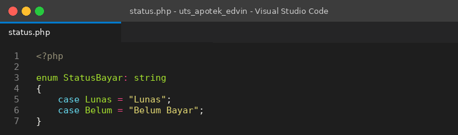

### File: `level.php` (baru)
**Penjelasan Kode:**
Enum `LevelMember` berisi tiga level. Bedanya dengan `StatusBayar`, enum ini punya method: `minPoin()` memberi batas poin, `diskon()` memberi persentase diskon, dan `dariPoin()` yang static mencari level tertinggi yang masih terjangkau. Aturan level cukup diubah di satu tempat ini; kelas `PelangganMember` tidak perlu disentuh.

**Screenshot Kode:**
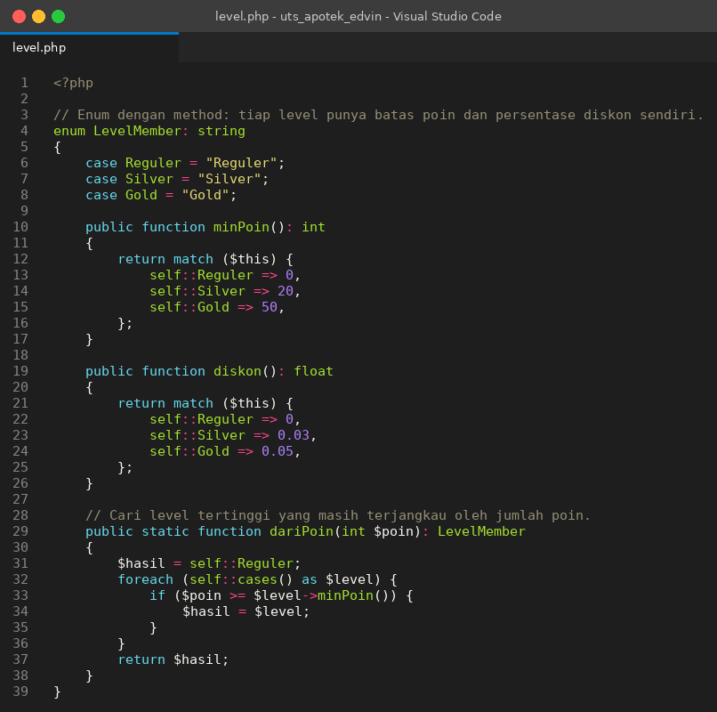

### File: `obat.php`
**Penjelasan Kode:**
Interface `BisaDijual`, abstract class `Obat`, dan dua turunannya, `ObatBebas` dan `ObatKeras`. Nama, harga, dan stok `private`. `ObatKeras` meng-override `hitungHarga()` dan memanggil `parent::hitungHarga()` sebelum menambah biaya resep Rp 5.000.

**Screenshot Kode:**
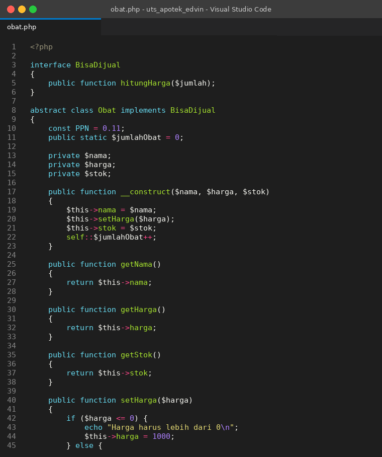

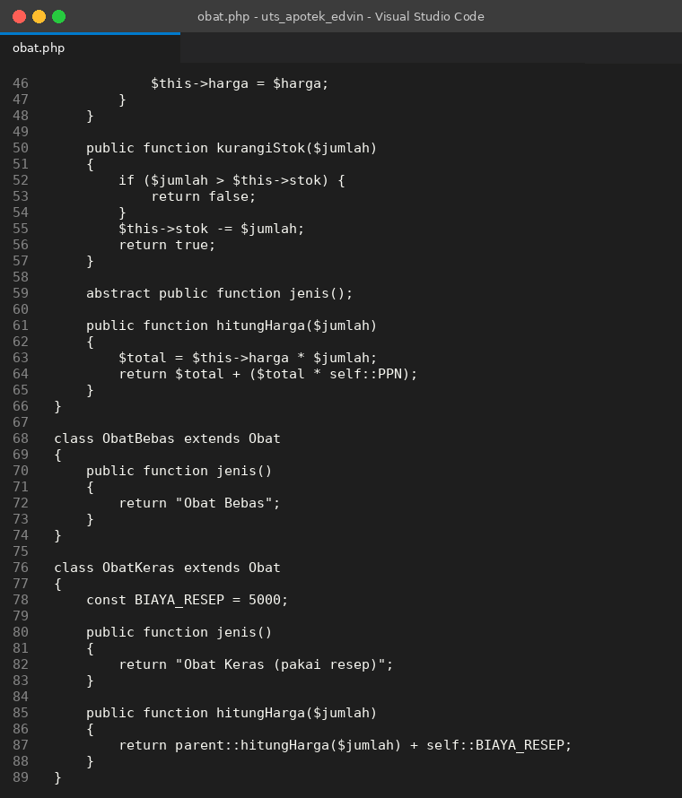

### File: `pelanggan.php` (dikembangkan, inilah bagian utama saya)
**Penjelasan Kode:**
Awalnya `Pelanggan` cuma kelas biasa dengan dua properti. Sekarang jadi `abstract class Pelanggan implements BisaDapatDiskon`.

Kelas induk memegang hal yang sama untuk semua pelanggan: ID otomatis dari penghitung static, nama, nomor HP, dan array `$riwayat` berisi objek `Transaksi`. Setter `setNoHp()` menerima `"-"` atau 10 sampai 13 digit angka; nilai lain diganti `"-"` dan program memberi tahu. `getTotalBelanja()` hanya menjumlah transaksi berstatus Lunas, sedangkan `cetakRiwayat()` mencetak semuanya.

Dua method dibiarkan abstract karena jawabannya memang beda: `jenis()` dan `tambahPoin()`. `hitungDiskon()` datang dari interface.

- `PelangganUmum`: `hitungDiskon()` dan `tambahPoin()` selalu mengembalikan 0.
- `PelangganMember`: punya `$poin` dan `$level`. `tambahPoin()` mengubah total bayar jadi poin dengan `intdiv`, lalu mengecek `LevelMember::dariPoin()`. Kalau levelnya berubah, level diganti dan pengumuman naik level dicetak. `hitungDiskon()` mengalikan total dengan `diskon()` dari levelnya. `tampilkanProfil()` di-override dan memanggil `parent::tampilkanProfil()` dulu sebelum mencetak poin dan diskon.

Karena `Transaksi` cukup memanggil `$pelanggan->tambahPoin()` tanpa tahu pelanggannya jenis apa, tidak ada satu pun `if` pengecekan jenis di kode. Kalau suatu hari ada `PelangganKaryawan`, kelas itu tinggal dibuat.

**Screenshot Kode:**
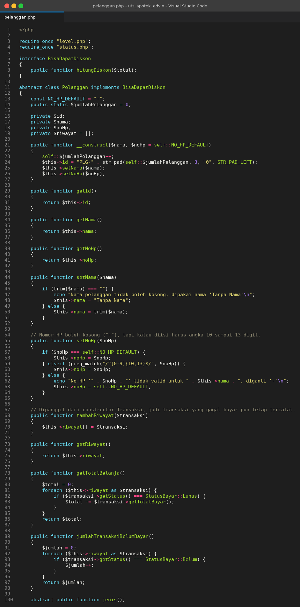

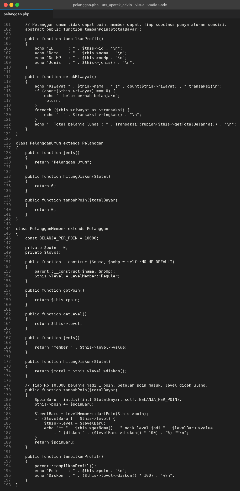

### File: `transaksi.php` (disesuaikan)
**Penjelasan Kode:**
`Transaksi` menyimpan objek `Pelanggan` dan `Obat` (relasi objek). Di constructor, transaksi mendaftarkan dirinya ke `$pelanggan->tambahRiwayat($this)`, jadi relasinya dua arah dan transaksi yang gagal pun tercatat.

Harga dipecah jadi `getSubtotal()` (harga obat plus PPN dan resep), `getDiskon()`, dan `getTotalBayar()`. Satu hal yang sempat jadi bug waktu saya uji: diskon awalnya dihitung ulang setiap kali struk dicetak, sehingga transaksi yang dibayar saat Budi masih Reguler ikut tercetak berdiskon 3% setelah dia naik ke Silver. Sekarang diskon disimpan di `$diskonTersimpan` begitu transaksi lunas. Sebelum lunas, nilainya masih estimasi dari level saat ini.

`bayar()` menolak transaksi yang sudah lunas, mengurangi stok kalau cukup, lalu memberi poin.

**Screenshot Kode:**
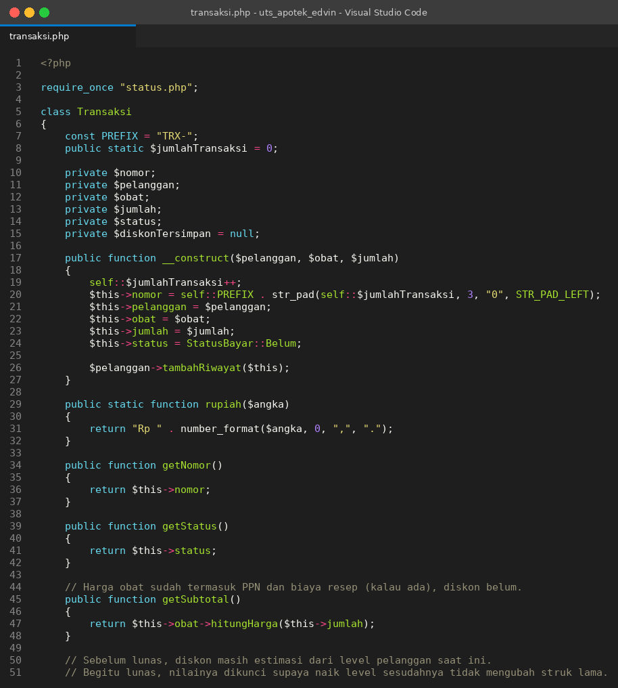

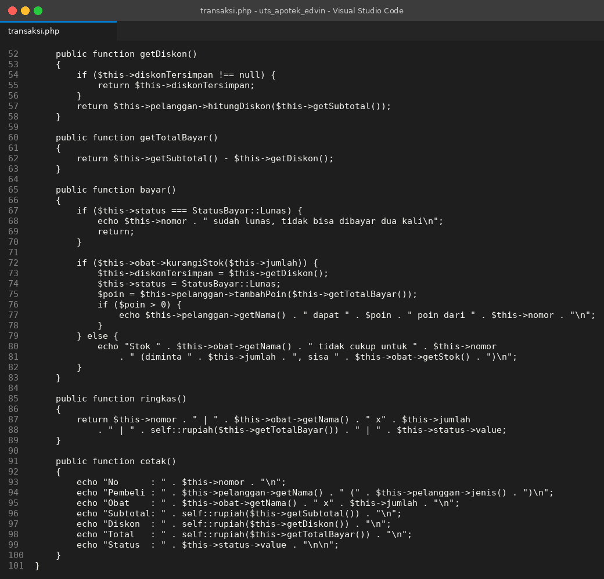

### File: `main.php`
**Penjelasan Kode:**
Skenario demo yang jalan dari awal sampai akhir: bikin 3 obat, daftarkan 4 pelanggan (2 member, 2 umum, satu nomor HP sengaja salah), buat 8 transaksi, bayar, cetak struk, cetak riwayat, profil akhir, peringkat, dan sisa stok.

Skenario sengaja disusun supaya tiap aturan muncul di output:

- Budi (member) belanja sampai poinnya 24 dan naik ke Silver; TRX-001 dan TRX-002 dibayar saat Reguler (tanpa diskon), TRX-003 dibayar saat Silver (diskon 3%).
- TRX-004 minta 10 Amoxicillin padahal stok 5, jadi gagal dan tetap Belum Bayar.
- Rina (member) tidak cukup poin untuk naik level, dan TRX-008 sengaja tidak dibayar.
- Doni mendaftar dengan nomor `abc123`, ditolak validasi, dan jadi `-`.
- `$t1->bayar()` dipanggil dua kali untuk menguji penolakan bayar ganda.

**Screenshot Kode:**
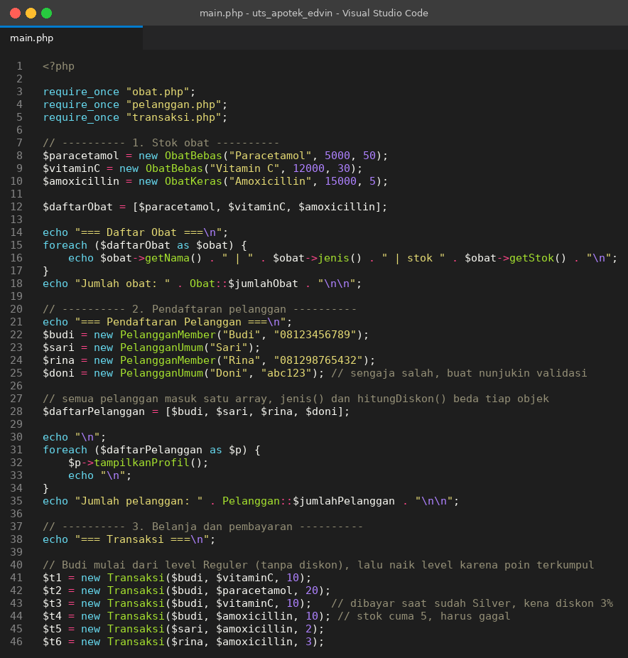

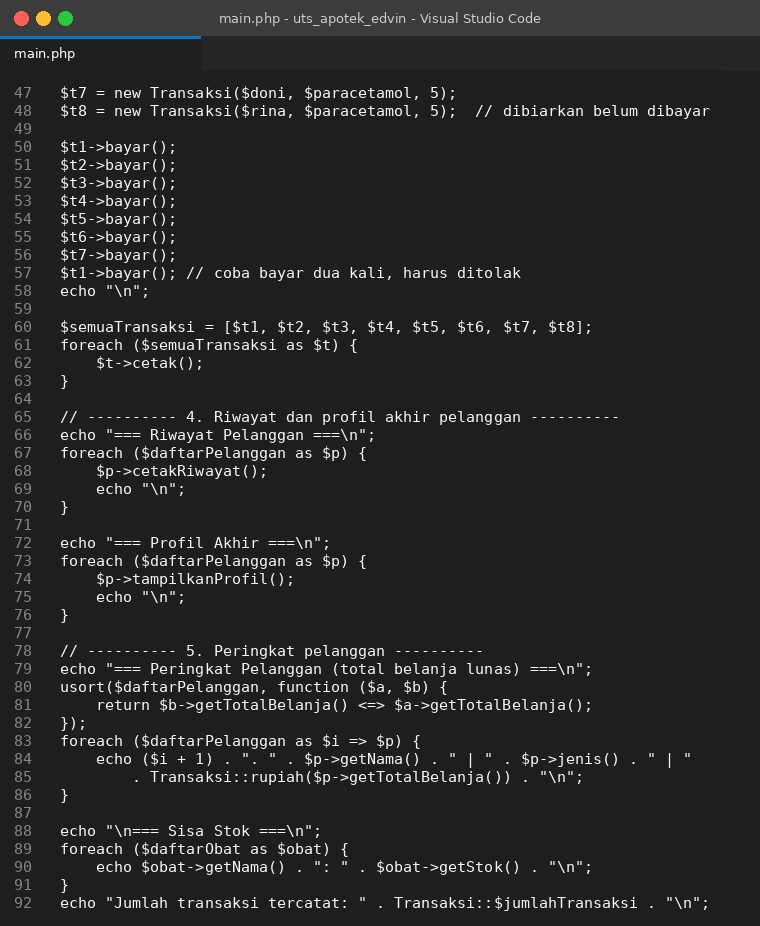

### Output
**Hasil Running Program (PHP):**
Dijalankan dengan `php main.php` di folder `php` (PHP 8.3).

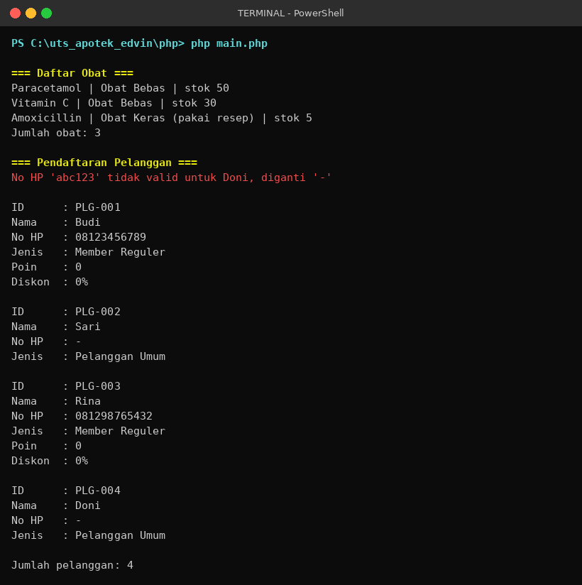

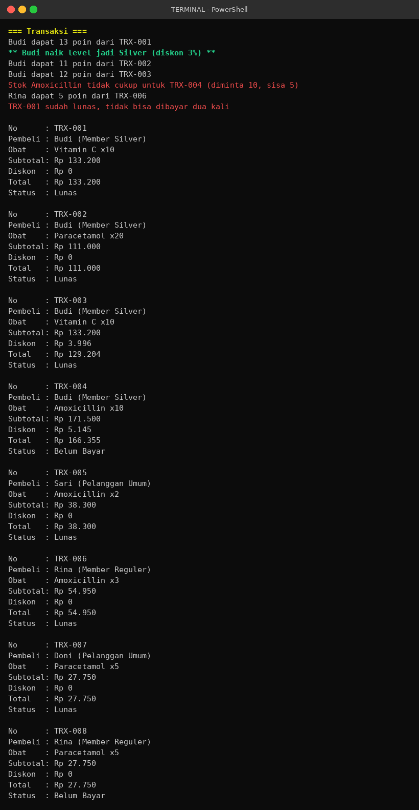

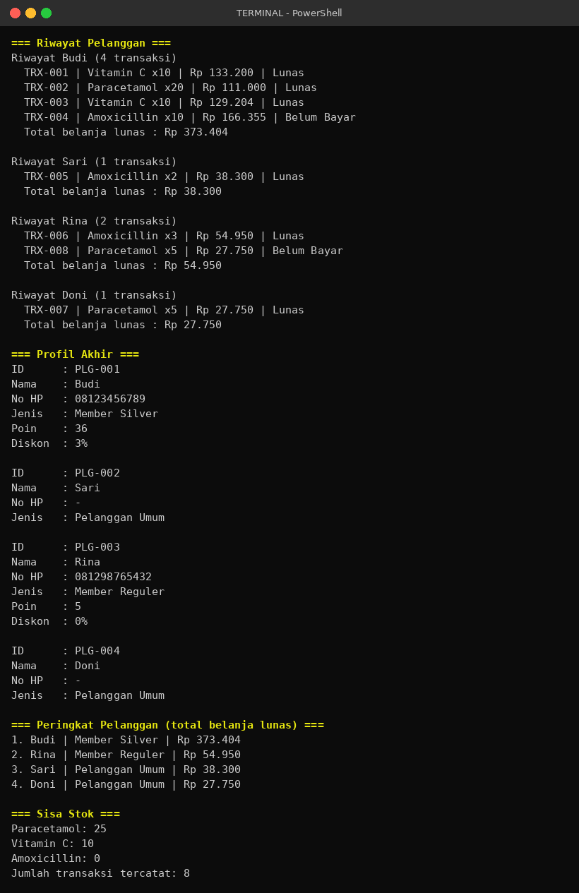

<details>
<summary>Output dalam bentuk teks</summary>

```
=== Daftar Obat ===
Paracetamol | Obat Bebas | stok 50
Vitamin C | Obat Bebas | stok 30
Amoxicillin | Obat Keras (pakai resep) | stok 5
Jumlah obat: 3

=== Pendaftaran Pelanggan ===
No HP 'abc123' tidak valid untuk Doni, diganti '-'

ID      : PLG-001
Nama    : Budi
No HP   : 08123456789
Jenis   : Member Reguler
Poin    : 0
Diskon  : 0%

ID      : PLG-002
Nama    : Sari
No HP   : -
Jenis   : Pelanggan Umum

ID      : PLG-003
Nama    : Rina
No HP   : 081298765432
Jenis   : Member Reguler
Poin    : 0
Diskon  : 0%

ID      : PLG-004
Nama    : Doni
No HP   : -
Jenis   : Pelanggan Umum

Jumlah pelanggan: 4

=== Transaksi ===
Budi dapat 13 poin dari TRX-001
** Budi naik level jadi Silver (diskon 3%) **
Budi dapat 11 poin dari TRX-002
Budi dapat 12 poin dari TRX-003
Stok Amoxicillin tidak cukup untuk TRX-004 (diminta 10, sisa 5)
Rina dapat 5 poin dari TRX-006
TRX-001 sudah lunas, tidak bisa dibayar dua kali

No      : TRX-001
Pembeli : Budi (Member Silver)
Obat    : Vitamin C x10
Subtotal: Rp 133.200
Diskon  : Rp 0
Total   : Rp 133.200
Status  : Lunas

No      : TRX-002
Pembeli : Budi (Member Silver)
Obat    : Paracetamol x20
Subtotal: Rp 111.000
Diskon  : Rp 0
Total   : Rp 111.000
Status  : Lunas

No      : TRX-003
Pembeli : Budi (Member Silver)
Obat    : Vitamin C x10
Subtotal: Rp 133.200
Diskon  : Rp 3.996
Total   : Rp 129.204
Status  : Lunas

No      : TRX-004
Pembeli : Budi (Member Silver)
Obat    : Amoxicillin x10
Subtotal: Rp 171.500
Diskon  : Rp 5.145
Total   : Rp 166.355
Status  : Belum Bayar

No      : TRX-005
Pembeli : Sari (Pelanggan Umum)
Obat    : Amoxicillin x2
Subtotal: Rp 38.300
Diskon  : Rp 0
Total   : Rp 38.300
Status  : Lunas

No      : TRX-006
Pembeli : Rina (Member Reguler)
Obat    : Amoxicillin x3
Subtotal: Rp 54.950
Diskon  : Rp 0
Total   : Rp 54.950
Status  : Lunas

No      : TRX-007
Pembeli : Doni (Pelanggan Umum)
Obat    : Paracetamol x5
Subtotal: Rp 27.750
Diskon  : Rp 0
Total   : Rp 27.750
Status  : Lunas

No      : TRX-008
Pembeli : Rina (Member Reguler)
Obat    : Paracetamol x5
Subtotal: Rp 27.750
Diskon  : Rp 0
Total   : Rp 27.750
Status  : Belum Bayar

=== Riwayat Pelanggan ===
Riwayat Budi (4 transaksi)
  TRX-001 | Vitamin C x10 | Rp 133.200 | Lunas
  TRX-002 | Paracetamol x20 | Rp 111.000 | Lunas
  TRX-003 | Vitamin C x10 | Rp 129.204 | Lunas
  TRX-004 | Amoxicillin x10 | Rp 166.355 | Belum Bayar
  Total belanja lunas : Rp 373.404

Riwayat Sari (1 transaksi)
  TRX-005 | Amoxicillin x2 | Rp 38.300 | Lunas
  Total belanja lunas : Rp 38.300

Riwayat Rina (2 transaksi)
  TRX-006 | Amoxicillin x3 | Rp 54.950 | Lunas
  TRX-008 | Paracetamol x5 | Rp 27.750 | Belum Bayar
  Total belanja lunas : Rp 54.950

Riwayat Doni (1 transaksi)
  TRX-007 | Paracetamol x5 | Rp 27.750 | Lunas
  Total belanja lunas : Rp 27.750

=== Profil Akhir ===
ID      : PLG-001
Nama    : Budi
No HP   : 08123456789
Jenis   : Member Silver
Poin    : 36
Diskon  : 3%

ID      : PLG-002
Nama    : Sari
No HP   : -
Jenis   : Pelanggan Umum

ID      : PLG-003
Nama    : Rina
No HP   : 081298765432
Jenis   : Member Reguler
Poin    : 5
Diskon  : 0%

ID      : PLG-004
Nama    : Doni
No HP   : -
Jenis   : Pelanggan Umum

=== Peringkat Pelanggan (total belanja lunas) ===
1. Budi | Member Silver | Rp 373.404
2. Rina | Member Reguler | Rp 54.950
3. Sari | Pelanggan Umum | Rp 38.300
4. Doni | Pelanggan Umum | Rp 27.750

=== Sisa Stok ===
Paracetamol: 25
Vitamin C: 10
Amoxicillin: 0
Jumlah transaksi tercatat: 8
```

</details>

---

## GitHub

Seluruh folder ini di-push ke repo kelompok. Saran pesan commit supaya riwayatnya rapi dan sesuai isi perubahan, misalnya `feat: tambah enum LevelMember`, `feat: Pelanggan jadi abstract, tambah PelangganUmum dan PelangganMember`, `feat: riwayat transaksi dan diskon member`, `fix: kunci diskon saat transaksi lunas`.

---

## Kesimpulan

Saya mulai dari kerangka yang sudah ada: pembeli cuma dua properti dan tidak berpengaruh apa-apa pada harga. Setelah dikembangkan, pelanggan menentukan diskon, mengumpulkan poin, dan punya riwayat. Hampir semua materi pertemuan 1 sampai 7 terpakai karena memang dibutuhkan, bukan ditempel.

Bagian yang paling terasa manfaatnya adalah abstract class dan polimorfisme. `Transaksi` tidak peduli pelanggannya umum atau member; ia memanggil `hitungDiskon()` dan `tambahPoin()` lalu jawabannya mengikuti jenis objek. Enum `LevelMember` juga menyelamatkan banyak `if`, sebab ambang poin dan persentase diskon ada di satu tempat.

Kelemahan yang masih ada: satu transaksi cuma untuk satu jenis obat, dan program berjalan dari skenario tetap di `main.php`, belum menerima input dari pengguna. Dua hal itu jadi kandidat pengembangan berikutnya, begitu juga penyimpanan data ke file atau database supaya poin tidak hilang saat program ditutup.

Soal kerja kelompok: pembagian per file membuat pekerjaan tidak saling tabrak. Syamil dengan enum status, Qowiyul dan Naufalino dengan kelas obat, Arkan dan Ayu dengan transaksi sudah rapi sebelum fitur pelanggan masuk, jadi menambah poin, level, dan diskon tidak memaksa kami membongkar kelas lain. Edvin sebagai PJ yang menyatukan semuanya.
